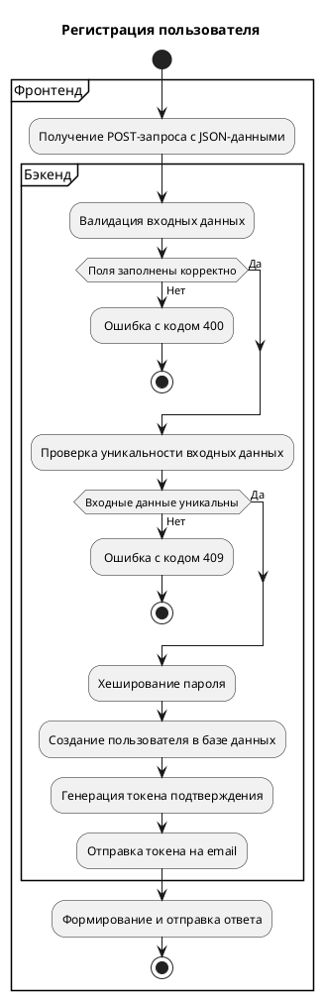

# Задача 1 11

# Задача 2

## User Story
Как продавец, я хочу иметь возможность разместить товар на маркетплейсе, чтобы покупатели смогли увидеть его и приобрести,

### Acceptance Criteria:
- Для размещения товара продавцу необходимо быть авторизованным в личном кабинете маркетплейса
- Продавцу доступна форма добавления товара
- Форма добавления товара включает обязательные поля "Название", "Описание", "Стоимость"
- Продавец должен прикрепить минимум одну фотографию товара
- После успешного добавления товар находится в разделе "Товары" в статусе "Активно"
- После неуспешного добавления товар находится в разделе "Черновик"
- Продавец может изменять параметры товара, кроме статуса, который меняется системой автоматически
- Продавец имеет право удалить карточку товара или перенести в раздел "Черновики"
- После продажи всех единиц товар находится в разделе "Товары", статус карточки товара автоматически превращается в "Неактивно"

## Use Case

**Название:** UC-1 размещение товара на маркетплейсе

**Назначение:** описывает процесс добавления нового товара продавцом для публикации на маркетплейсе

**Границы рассмотрения:** UC охватывает процесс публикации товара на витрине маркетплейса через личный кабинет продавца

**Основное действующее лицо (пользователь):** авторизированный продавец

**Второстепенные действующие лица:** система маркетплейса (витрина товаров)

**Предусловие:** продавец авторизировался в приложении, перешёл в раздел "Добавление товара"

**Постусловие - минимальные гарантии:** после неуспешного добавления товар находится в разделе "Черновик"

**Постусловие - успешные гарантии:** после успешного добавления товар находится в разделе "Товары", статус "Активно"

**Триггер:** продавец открыл форму добавления товара

**Диаграмма:** диаграмма Use Case

### Основной сценарий:
1. Система отобразила форму для добавления характеристик товара
2. Продавец заполняет обязательные поля: "Название", "Описание", "Стоимость"
   - а. Альтернативный сценарий 1
3. Продавец нажимает на кнопку "Далее"
4. Система отображает страницу добавление фотографии товара
5. Продавец прикрепляет фотографию товара
   - а. Альтернативный сценарий 2
   - б. Альтернативный сценарий 3
6. Нажимает на кнопку "Создать товар"/"Добавить товар"
7. Система сохраняет товар в базу данных
8. Система добавляет товар на витрину товаров
9. Система добавляет созданный товар в раздел "Товары", статус "Активно"
   - а. Альтернативный сценарий 4

### Альтернативный сценарий 1 - Пропущены обязательные поля (к шагу 2)
1. Система подсвечивает рамку поля красным светом
2. Система отображает "Пожалуйста, заполните поле"
3. Кнопка "Создать товар"/"Добавить товар" неактивна
4. При заполнении поля - продолжение основного сценария с шага 3

### Альтернативный сценарий 2 - Не прикреплена фотография/и (к шагу 5)
1. Система подсвечивает рамку поля красным светом
2. Система отображает "Пожалуйста, прикрепите фотографию"
3. Кнопка "Создать товар"/"Добавить товар" неактивна
4. При добавлении фотографии - продолжение основного сценария с шага 6

### Альтернативный сценарий 3 - Возникновение ошибки при добавлении фотографии или выход из системы маркетплейса (к шагу 5)
1. Система сохраняет данные, введённые в полях "Название", "Описание", "Стоимость", в раздел "Черновик"
2. При добавлении фотографии в созданный "Черновик" - продолжение основного сценария с шага 6

### Альтернативный сценарий 4 - Возникновение ошибки при добавлении товара (к шагу 9)
1. Система сохраняет данные товара в раздел "Черновик"
2. При повторном нажатии кнопки "Создать товар"/"Добавить товар" из раздела "Черновик" - продолжение основного сценария с шага 7

---

# Задача 3

## Задание 3.1.

### 1. Название API
Book Store Registration Endpoint предназначен для регистрации нового пользователя.

**Базовый URL:** https://bookstore.ru/api/v1  
**Endpoint:** POST /register

### 2. Основная информация

**Автор:**  
Анна Мещерякова

**Задача:**  
Реализовать возможность взаимодействия фронтенд и бэкенд при нажатии на кнопку “Register”.

**Бизнес постановка:**  
Пользователь хочет зарегистрироваться в приложении книжного магазина.

Для этого пользователь вводит все данные запрашиваемые фронтендом в нужные поля, ставит галочку в поле с надписью “I’m not a robot” и нажимает на кнопку “Register”.

Бэк сервис создаёт учётную запись пользователя и переводит его на главную страницу.

### 2.1. История изменений документа

| Версия | Дата       | Автор           | Описание изменений                     |
|--------|------------|-----------------|----------------------------------------|
| v1     | 31.10.2025 | Анна Мещерякова | Первоначальная версия спецификации API |

### 3. Входные параметры

| № | Параметр        | Тип данных                    | Обязательность | Описание                                                                                                                                              | Пример значения                                              |
|---|-----------------|-------------------------------|----------------|-------------------------------------------------------------------------------------------------------------------------------------------------------|--------------------------------------------------------------|
| 1 | first_name      | string                        | да             | Имя пользователя                                                                                                                                      | Ivan                                                         |
| 2 | last_name       | string                        | да             | Фамилия пользователя                                                                                                                                  | Ivanov                                                       |
| 3 | user_name       | string                        | да             | Логин пользователя. Используется для авторизации. Должен быть уникальным.                                                                             | Ivan                                                         |
| 4 | password        | string (minLength: 8 symbols) | да             | Пароль пользователя                                                                                                                                   | PassWor_d563                                                 |
| 5 | recaptcha_token | string                        | да             | Токен подтверждения reСaptcha, получаемый с фронта при нажатии “I’m not a robot”, передаётся на бэкенд и проверяется. Строка длиной 100-500 символов. | "03AOLTBLQ...example_token_abcdefghijklmnopqrstuvwxyz123456" |

### 3.1. Проверки

| Параметр        | Проверка                                                                                                                                                                                                                                                                       |
|-----------------|--------------------------------------------------------------------------------------------------------------------------------------------------------------------------------------------------------------------------------------------------------------------------------|
| first_name      | Проверяется наличие значения. Если имя не введено и/или содержит цифры/спецсимволы, сервис не создаёт учётную запись и возвращает ошибку с кодом 400 Bad Request.                                                                                                              |
| last_name       | Проверяется наличие значения. Если фамилия не введена и/или содержит цифры/спецсимволы, сервис не создаёт учётную запись и возвращает ошибку с кодом 400 Bad Request.                                                                                                          |
| user_name       | Проверяется наличие и уникальность значения значения. Если имя не введено, сервис не создаёт учётную запись и возвращает ошибку с кодом 400 Bad Request. Если имя уже зарегистрировано, сервис не создаёт учётную запись и возвращает ошибку с кодом 409 Conflict.             |
| password        | Проверяется наличие и надёжность введённого пароля. Минимальная длина (не менее 8 символов) и сложность (наличие букв, цифр и спецсимволов). Если пароль не введён или не удовлетворяет условию, сервис не создаёт учётную запись и возвращает ошибку с кодом 400 Bad Request. |
| reCaptcha_token | Проверяется установка галочки в поле “I’m not a robot”. Если пользователь не поставил галочку, сервис не создаёт учётную запись и возвращает ошибку валидации с кодом 400 Bad Request.                                                                                         |

### 4. Выходные параметры

#### 4.1. Положительный ответ
Код HTTP 200 ОК - запрос выполнен успешно  
Тело положительного ответа содержит json-объект c сообщением - “User Register Succesfully.”

| Наименование | Тип    | Обязательность | Описание                  | Ограничения                                 | Пример                     |
|--------------|--------|----------------|---------------------------|---------------------------------------------|----------------------------|
| message      | string | да             | Текстовое описание ошибки | Сообщение должно быть понятным пользователю | User Register Succesfully. |

#### 4.2. Ответ с ошибками

| Наименование | Тип     | Обязательность | Описание                  | Ограничения                                 | Пример                               |
|--------------|---------|----------------|---------------------------|---------------------------------------------|--------------------------------------|
| code         | integer | да             | Код ошибки                | Клиентская ошибка 4xx                       | 400                                  |
| message      | string  | да             | Текстовое описание ошибки | Сообщение должно быть понятным пользователю | Please verify reCaptcha to register! |

**Код | Описание**  
400 | Неправильный, некорректный запрос. Введены данные, которые не соответствуют требуемому формату.  
409 | Конфликт запроса с текущим состоянием сервера. Пользователь ввёл уже зарегистрированный логин или почтовый адрес.

### 5. Пример запроса и ответа

#### Успешный запрос
```json
POST https://bookstore.ru/api/v1/register HTTP/1.1
Content-Type: application/json

{
   "first_name": "Ivan",
   "last_name": "Ivanov",
   "user_name": "Ivan",
   "password": "PassWor_d563",
   "recaptcha_token": "03AOLTBLQ...example_token_abcdefghijklmnopqrstuvwxyz123456"
}
````

#### Успешный ответ

```json
HTTP/1.1 200 ОК
Content-Type: application/json

{
"message": "User Register Succesfully. "
}
```

#### Ошибка (валидатор пароля)

```json
POST https://bookstore.ru/api/v1/register HTTP/1.1
Content-Type: application/json

{
   "first_name": "Ivan",
   "last_name": "Ivanov",
   "user_name": "Ivan",
   "password": "Password",
   "recaptcha_token": "03AOLTBLQ...example_token_abcdefghijklmnopqrstuvwxyz123456"
}

HTTP/1.1 400 Bad Request
Content-Type: application/json

{
   "code": 400,
   "message": "Password must have at least one non alphanumeric character, one digit (“0”- ‘9’), one uppercase (‘A’- ‘Z’), one lowercase (a-z), one special character and Password must be eight character or longer"
}
```

#### Ошибка (нет recaptcha_token)

```json
POST https://bookstore.ru/api/v1/register HTTP/1.1
Content-Type: application/json

{
   "first_name": "Ivan",
   "last_name": "Ivanov",
   "user_name": "Ivan",
   "password": "PassWor_d563"
}

HTTP/1.1 400 Bad Request
Content-Type: application/json

{
   "code": 400,
   "message": "Please verify reCaptcha to register!"
}
```

#### Ошибка (пользователь существует)

```json
POST https://bookstore.ru/api/v1/register HTTP/1.1
Content-Type: application/json

{
   "first_name": "Ivan",
   "last_name": "Ivanov",
   "user_name": "Ivan",
   "password": "PassWor_d563",
   "recaptcha_token": "03AOLTBLQ...example_token_abcdefghijklmnopqrstuvwxyz123456"
}

HTTP/1.1 409 Conflict
Content-Type: application/json

{
   "code": 409,
   "message": "User exists!"
}
```

---

## Задание 3.2



